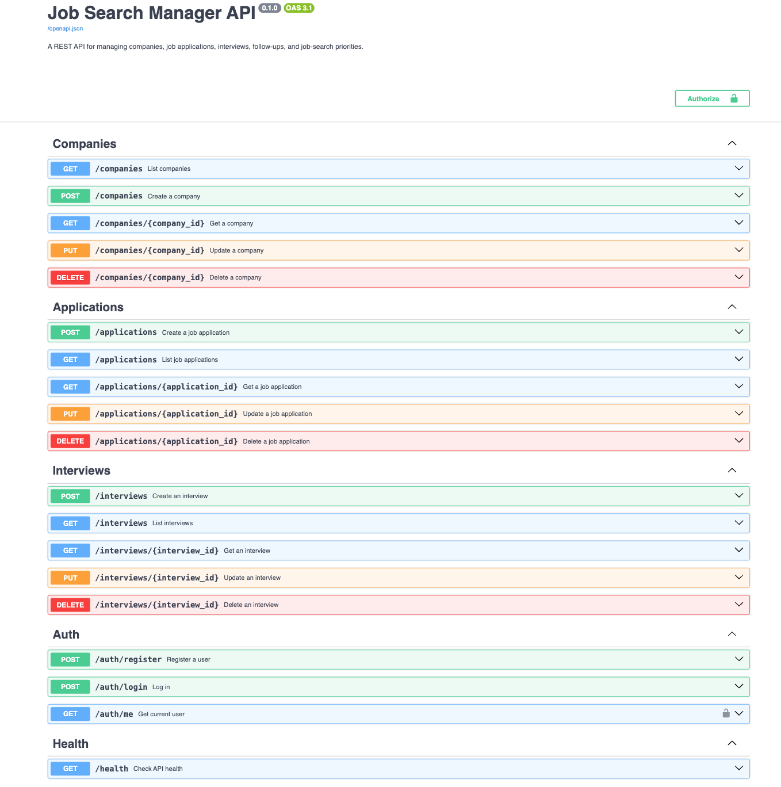
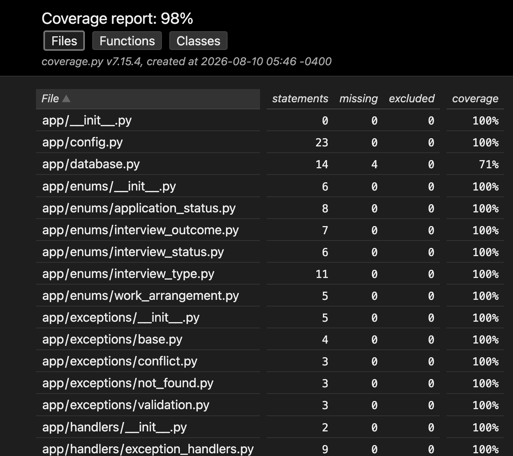
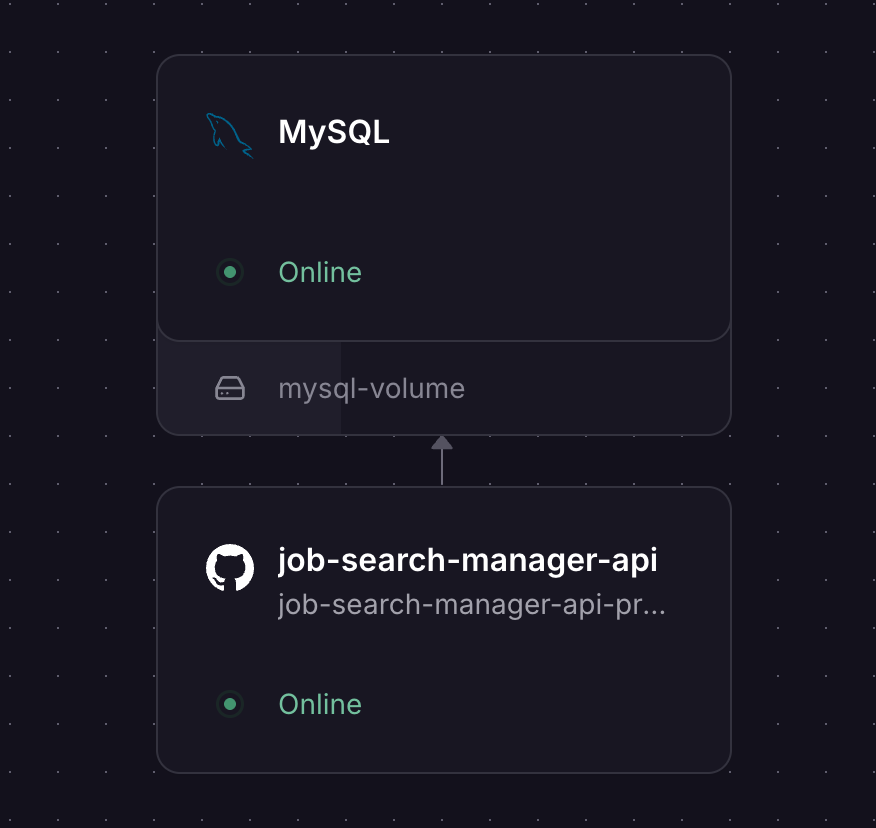

# Job Search Manager API

[](https://github.com/garrib10/job-search-manager-api/actions/workflows/ci.yml)


A REST API built with **FastAPI**, **SQLAlchemy**, and **MySQL** for managing a job search. Each user registers, logs in with a JWT, and tracks their own companies, job applications, and interviews; one user's records are never visible to another.

The project follows a layered architecture with separate routers, services, models, and schemas. Schema changes are managed with Alembic migrations, every pull request runs the test suite against MySQL in CI, and the API is deployed to Railway.

---

## Live Demo

| Resource        | URL                                                             |
| --------------- | --------------------------------------------------------------- |
| Production API  | https://job-search-manager-api-production.up.railway.app        |
| Swagger UI      | https://job-search-manager-api-production.up.railway.app/docs   |
| Health Endpoint | https://job-search-manager-api-production.up.railway.app/health |

The live demo runs the latest release from the `main` branch. Work merged into `develop` appears there after the next release.

---

## Key Features

### Company Management

- Create, update, retrieve, and delete companies
- Store company website, industry, location, and notes
- Paginated list ordered by name, then ID
- A company that still has job applications can't be deleted (`409 Conflict`); delete or move its applications first
- Company names don't have to be unique

### Job Application Management

- Track job applications
- Associate applications with companies
- Store salary ranges, work arrangement, application status, and notes
- Prevent tracking the same posting twice: a job URL is unique per user, and different users can track the same posting
- Deleting an application also deletes its interviews

### Interview Management

- Schedule interviews
- Track interview type, status, and outcome
- Prevent scheduling the same application twice at the same moment
- Associate interviews with job applications
- Times are sent with a UTC offset and returned in UTC

### Authentication

- User registration
- Secure password hashing with Argon2
- JWT access tokens
- Every company, application, and interview endpoint requires a bearer token
- Each user only sees and changes their own records; another user's record returns `404 Not Found`, the same as a missing one
- Applications can only be filed under the user's own companies, and interviews under the user's own applications

### Follow-ups

- Add to-dos to an application (for example, "Email the recruiter") with a due date
- Mark them completed or reopen them; the server records when each was completed
- Filter by `open`, `completed`, `overdue` (open and due before today), or `upcoming` (open and due within the next 7 days, including today), using the UTC date
- Deleting an application deletes its follow-ups

### Job Search Summary

- `GET /stats/summary` returns your applications by status, interviews by outcome, interviews in the next 7 days, and applications not updated for 14+ days
- Every count covers only your own records, and every status and outcome is listed (0 when empty)

### Search & Filtering

Job Applications

- Status
- Company
- Location
- Work Arrangement
- Date Applied
- Full-text search
- Sorting
- Pagination

Interviews

- Application
- Interview Type
- Status
- Outcome
- Scheduled Date
- Sorting
- Pagination

Companies

- Pagination

### Validation & Error Handling

- Global exception handlers with consistent error responses
- Request validation with Pydantic
- Required text is trimmed, and blank values are rejected
- Notes are limited to 65,535 bytes (MySQL `TEXT`)
- Datetimes must include a UTC offset (`2026-11-02T15:00:00Z`); values without one are rejected
- Duplicate detection, plus a generic `409 Conflict` for database constraint conflicts (details are logged, never returned)
- Date-range validation

### Automated Testing

- 213 automated tests, 99% code coverage
- Dedicated MySQL test database, with a guard that refuses to reset any database whose name lacks `test` or matches `DB_NAME`
- CRUD, validation, and end-to-end workflow tests
- Authentication and cross-user isolation tests
- Migration tests run against MySQL

---

## Tech Stack

### Backend

- Python 3.12+
- FastAPI
- SQLAlchemy
- MySQL
- PyMySQL

### Authentication

- PyJWT
- pwdlib (Argon2)
- HTTP Bearer Authentication

### Validation

- Pydantic
- pydantic-settings

### Database Migrations

- Alembic

### Testing

- Pytest
- pytest-cov
- HTTPX

### Documentation

- Swagger / OpenAPI

### CI and Security Scanning

- GitHub Actions (tests, Ruff, migration checks)
- CodeQL, Bandit, Dependency Review, Dependabot

### Deployment

- Railway

---

## Architecture

```
Client
      │
      ▼
FastAPI Routers
      │
      ▼
Service Layer
      │
      ▼
SQLAlchemy ORM
      │
      ▼
MySQL Database
```

The application follows a layered architecture that separates routing, business logic, validation, and database access to improve maintainability and testability.

---

## Project Structure

```text
app/
├── enums/            # Status, type, and outcome enums
├── exceptions/       # Application exceptions (not found, conflict, validation)
├── handlers/         # Global exception handlers
├── models/           # SQLAlchemy models
├── routers/          # FastAPI routes
├── schemas/          # Pydantic request/response models and shared field types
├── services/         # Business logic and owner-scoped queries
├── config.py         # Settings from environment variables
├── database.py       # Engine, sessions, commit/rollback helper
├── db_types.py       # UTC datetime column type
├── security.py       # Password hashing and JWTs
└── main.py           # FastAPI app

alembic/              # Migration environment and versions/
alembic.ini
docs/
├── database-migrations.md
└── design-decisions.md
scripts/
└── compare_schema.py # Read-only schema check before adopting migrations

tests/
├── conftest.py       # Fixtures, test database guard
├── db_safety.py      # Guards for destructive test setup
├── migration_utils.py
└── test_*.py         # API, isolation, validation, and migration tests
```

---

## Screenshots

### Swagger UI



### Test Coverage Report

Screenshot from v0.1.0 (70 tests). The current figures are under [Testing](#testing).



### Railway Deployment



## API Endpoints

### Health

| Method | Endpoint  |
| ------ | --------- |
| GET    | `/health` |

### Authentication

| Method | Endpoint         |
| ------ | ---------------- |
| POST   | `/auth/register` |
| POST   | `/auth/login`    |
| GET    | `/auth/me`       |

### Companies

| Method | Endpoint          |
| ------ | ----------------- |
| POST   | `/companies`      |
| GET    | `/companies`      |
| GET    | `/companies/{id}` |
| PUT    | `/companies/{id}` |
| DELETE | `/companies/{id}` |

### Job Applications

| Method | Endpoint             |
| ------ | -------------------- |
| POST   | `/applications`      |
| GET    | `/applications`      |
| GET    | `/applications/{id}` |
| PUT    | `/applications/{id}` |
| DELETE | `/applications/{id}` |

### Interviews

| Method | Endpoint           |
| ------ | ------------------ |
| POST   | `/interviews`      |
| GET    | `/interviews`      |
| GET    | `/interviews/{id}` |
| PUT    | `/interviews/{id}` |
| DELETE | `/interviews/{id}` |

### Follow-ups

| Method | Endpoint           |
| ------ | ------------------ |
| POST   | `/follow-ups`      |
| GET    | `/follow-ups`      |
| GET    | `/follow-ups/{id}` |
| PUT    | `/follow-ups/{id}` |
| DELETE | `/follow-ups/{id}` |

### Stats

| Method | Endpoint         |
| ------ | ---------------- |
| GET    | `/stats/summary` |

All company, application, interview, follow-up, and stats endpoints require `Authorization: Bearer <JWT>` and only work with the logged-in user's records.

---

## Example Requests

### Register

```http
POST /auth/register
```

```json
{
  "email": "user@example.com",
  "password": "TestPassword123!"
}
```

### Login

```http
POST /auth/login
```

```json
{
  "email": "user@example.com",
  "password": "TestPassword123!"
}
```

### Authenticated Request

```http
GET /auth/me
Authorization: Bearer <JWT>
```

### Schedule an Interview

```http
POST /interviews
Authorization: Bearer <JWT>
```

```json
{
  "application_id": 1,
  "interview_type": "technical",
  "scheduled_at": "2026-11-02T10:00:00-05:00"
}
```

The response returns the time in UTC: `"scheduled_at": "2026-11-02T15:00:00Z"`.

### Add and Complete a Follow-up

```http
POST /follow-ups
Authorization: Bearer <JWT>
```

```json
{
  "application_id": 1,
  "title": "Email the recruiter",
  "due_date": "2026-11-12"
}
```

To complete it, send the whole follow-up back with `"completed": true` (or `false` to reopen it):

```http
PUT /follow-ups/{id}
Authorization: Bearer <JWT>
```

```json
{
  "application_id": 1,
  "title": "Email the recruiter",
  "due_date": "2026-11-12",
  "completed": true
}
```

List what's overdue with `GET /follow-ups?status_filter=overdue`.

### Job Search Summary

```http
GET /stats/summary
Authorization: Bearer <JWT>
```

```json
{
  "generated_at": "2026-11-01T12:00:00Z",
  "applications_by_status": {"saved": 2, "applied": 5, "interviewing": 1, "offer": 0, "rejected": 1, "withdrawn": 0},
  "interviews_by_outcome": {"pending": 2, "advanced": 1, "rejected": 0, "offer": 0, "withdrawn": 0},
  "upcoming_interviews": {"count": 1, "window_start": "2026-11-01T12:00:00Z", "window_end": "2026-11-08T12:00:00Z"},
  "stale_applications": {"count": 3, "days": 14, "not_updated_since": "2026-10-18T12:00:00Z"}
}
```

- **upcoming_interviews:** scheduled from `window_start` (inclusive) to `window_end` (exclusive), excluding cancelled interviews.
- **stale_applications:** applications whose record was last updated at or before `not_updated_since`. Adding an interview doesn't update the application.

---

## Local Development

These steps take a fresh clone to a running API and a passing test suite.

### Prerequisites

- **Python 3.12.** The version is pinned in `.python-version`, which CI and Railway also read.
- **MySQL 8.4 or newer.** CI tests on 8.4; production runs 9.x.
- Git.

### 1. Clone and create a virtual environment

```bash
git clone https://github.com/garrib10/job-search-manager-api.git
cd job-search-manager-api
python3.12 -m venv .venv
source .venv/bin/activate
pip install -r requirements.txt
```

### 2. Create the databases

You need **two** databases: one for the app, and a separate, disposable one for the tests. The test suite drops and recreates every table in its database, and refuses to run unless that database's name contains `test` and differs from the app database.

As the MySQL `root` user (`mysql -u root -p`), create both databases and a user for the app (choose your own password):

```sql
CREATE DATABASE job_search_manager;
CREATE DATABASE job_search_manager_test;
CREATE USER 'job_manager_user'@'localhost' IDENTIFIED BY 'choose-a-password';
GRANT ALL PRIVILEGES ON job_search_manager.* TO 'job_manager_user'@'localhost';
GRANT ALL PRIVILEGES ON job_search_manager_test.* TO 'job_manager_user'@'localhost';
```

### 3. Configure `.env`

```bash
cp .env.example .env
```

Then edit `.env`:

| Variable | Required | Value |
| --- | --- | --- |
| `DB_HOST`, `DB_PORT` | Yes (port defaults to 3306) | `localhost`, `3306` |
| `DB_NAME` | Yes | `job_search_manager` |
| `DB_USER`, `DB_PASSWORD` | Yes | The MySQL user and password from step 2 |
| `TEST_DATABASE_URL` | For tests | `mysql+pymysql://job_manager_user:<password>@localhost:3306/job_search_manager_test` |
| `JWT_SECRET_KEY` | Yes | A random value of at least 32 bytes: `python -c "import secrets; print(secrets.token_urlsafe(48))"` |
| `JWT_ALGORITHM` | No (default `HS256`) | `HS256`, `HS384`, or `HS512` |
| `ACCESS_TOKEN_EXPIRE_MINUTES` | No (default `30`) | Login token lifetime |
| `APP_ENV` | No (default `development`) | Keep `development` locally. See [Deployment](#deployment) for what `production` enforces |

`.env` is git-ignored. Never commit real values.

If the test password contains special characters (`@`, `:`, `/`, `%`), URL-encode it in `TEST_DATABASE_URL`.

### 4. Create the schema

The app never creates tables on startup. Apply the migrations:

```bash
alembic upgrade head
```

If your database was created by an older version of this project, adopt it instead; see [docs/database-migrations.md](docs/database-migrations.md).

### 5. Run the API

```bash
uvicorn app.main:app --reload
```

Open http://127.0.0.1:8000/docs:

1. Call `POST /auth/register`, then `POST /auth/login`.
2. Click **Authorize** and paste the `access_token`.
3. The company, application, and interview endpoints now work with your account.

---

## Testing

The tests use the database in `TEST_DATABASE_URL` from step 3, never `DB_NAME`.

Run the tests with coverage:

```bash
python -m pytest --cov=app --cov-report=term-missing
```

Run the same lint check as CI. Ruff isn't in `requirements.txt`; CI installs this exact version:

```bash
pip install ruff==0.17.1
ruff check .
```

Check that the migrations match the models, as CI does. This runs against `DB_NAME`:

```bash
alembic upgrade head
alembic check
python -m scripts.compare_schema
```

The suite covers:

- Authentication and the production settings guard
- Companies, job applications, and interviews
- Cross-user isolation, including search, filters, sorting, and pagination with interleaved data from two users
- Validation, timezones, and exception handling
- Database migrations
- Deployment configuration and end-to-end workflows

Current test suite:

- **328 automated tests**
- **99% code coverage**

Every pull request runs these checks in GitHub Actions against a disposable MySQL 8.4 database, alongside CodeQL, Bandit, and Dependency Review.

---

## Deployment

The API is deployed on [Railway](https://railway.com) from the `main` branch. The deployment settings are in the repository:

| File | Purpose |
| --- | --- |
| `.railway/railway.ts` | Railway Infrastructure as Code for the API service: start command (`uvicorn app.main:app --host 0.0.0.0 --port $PORT`), pre-deploy command (`alembic upgrade head`, 300-second timeout), health check (`/health`), builder, and source branch |
| `.railway/package.json` | Pins the Railway SDK that `railway config` uses to read `railway.ts`. Kept out of the repository root so Railway still builds a Python app |
| `.python-version` | Python 3.12, also used by CI |

On each deploy, Railway runs the migrations **before** switching traffic to the new version. If a migration fails, the deploy stops and the previous version keeps running. Migrations that need manual input are described in [docs/database-migrations.md](docs/database-migrations.md#migrations-on-deploy-railway).

### Changing deployment settings

Railway doesn't read `.railway/` during deploys; changes take effect when they're applied with the [Railway CLI](https://docs.railway.com/cli). After a change to `.railway/railway.ts` is merged:

```bash
cd .railway && npm ci && cd ..      # install the pinned Railway SDK (Node 22+)
railway link                        # once: select the project and the production environment
railway config plan                 # read-only preview
railway config apply                # apply the reviewed changes
```

Check that the plan says `0 to destroy` before applying. The file declares `partial = "job-search-manager-api"`, so it only manages the API service, never the MySQL database, and `variables.managed: false` leaves environment variables in Railway.

### Required production settings

Set these as variables on the Railway service. With `APP_ENV=production`, the app (and the pre-deploy migration) **refuses to start** if any of them are unsafe:

| Variable | Requirement |
| --- | --- |
| `APP_ENV` | `production` |
| `JWT_SECRET_KEY` | At least 32 bytes for HS256 (48 for HS384, 64 for HS512), and not a value from this repository |
| `JWT_ALGORITHM` | `HS256`, `HS384`, or `HS512` |
| `ACCESS_TOKEN_EXPIRE_MINUTES` | Between 1 and 1440 |
| `DB_HOST`, `DB_PORT`, `DB_NAME`, `DB_USER`, `DB_PASSWORD` | The Railway MySQL connection; `DB_PASSWORD` must not be empty |

The startup error names each problem without showing any values. Changing `JWT_SECRET_KEY` signs out existing users; they just log in again.

---

## Future Enhancements

- Refresh tokens
- Role-based authorization
- Docker support
- Email notifications
- Saved searches
- Application reminders

---

## License

MIT
